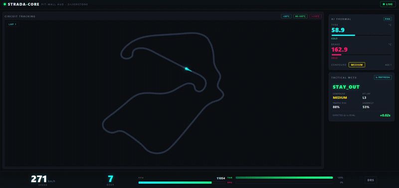
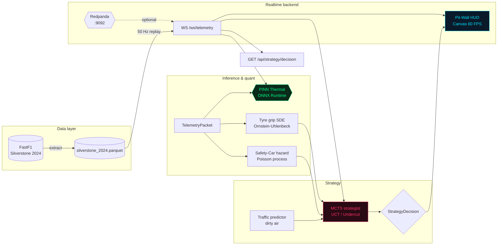

<!-- Badges -->
<p align="center">
  
  
  
  
  
</p>

# STRADA-CORE

**Real-time Formula 1 race-strategy engine — Physics-Informed Edge AI for the pit wall.**

STRADA-CORE turns raw telemetry into race decisions on CPU. It replays a full Grand Prix
at 50 Hz, infers tyre and brake temperatures with a Physics-Informed Neural Network
compiled to **ONNX Runtime**, models tyre grip loss with a vectorised Ornstein–Uhlenbeck
SDE, quantifies Safety-Car risk with a non-homogeneous Poisson process, and picks the pit
window (Undercut vs Overcut) with a **Monte Carlo Tree Search** — all surfaced through a
FastAPI/WebSocket backend and a 60 FPS Canvas pit-wall HUD.

## Value proposition

| Pillar | What it delivers |
| --- | --- |
| **Edge AI** | Thermal surrogate runs in **~0.04 ms** on CPU via ONNX — no GPU, no PyTorch at inference time (Rule #2). |
| **100 Hz telemetry class** | Validated Pydantic v2 packets generated at **~31,800 packets/s**, streamed live over WebSockets. |
| **Physics, not guesswork** | Grip degradation is an SDE driven by the PINN's thermal output; strategy is an adversarial MCTS. |
| **Production-hardened** | Single-container build, clean Kafka/WS disconnects, `uv`-managed, 19/19 tests green. |



## System architecture



## Mathematical foundations

### Physics-Informed Neural Network — composite loss

The thermal surrogate is trained to respect Newton's law of cooling plus frictional /
braking heat, penalising thermodynamic violations through `torch.autograd`:

$$\mathcal{L} \;=\; \underbrace{\frac{1}{N}\sum_{i}\big(\hat{T}_i - T_i\big)^2}_{\mathcal{L}_{\text{data (MSE)}}} \;+\; \lambda_{\text{physics}}\;\underbrace{\frac{1}{N}\sum_i \mathcal{R}_i^2}_{\mathcal{L}_{\text{physics}}}$$

where the residual encodes the steady-state form of the energy balance,

$$\mathcal{R} \;=\; \alpha\,(b \cdot v) \;+\; \beta\,a_{\text{lat}} \;-\; \gamma\,(T - T_{\text{amb}}), \qquad \frac{dT}{dt} = \mathcal{R}$$

with $b$ brake load, $v$ speed, $a_{\text{lat}}$ lateral acceleration and $T_{\text{amb}}$ ambient.

### Tyre grip degradation — Ornstein–Uhlenbeck SDE

Grip $G_t \in [0,1]$ mean-reverts toward a wear-dependent baseline, with thermal
acceleration of the decay outside the optimal window:

$$dG_t = -\theta_{\text{eff}}(T)\,\big(G_t - \mu_{\text{base}}(\text{age})\big)\,dt + \sigma\,dW_t$$

$$\theta_{\text{eff}}(T) = \theta_0 \cdot \begin{cases} 1 + k_{\text{hot}}\dfrac{T - T_{\text{hi}}}{20}, & T > T_{\text{hi}} \\[2pt] 1, & T_{\text{lo}} \le T \le T_{\text{hi}} \\[2pt] 1 + k_{\text{cold}}\dfrac{T_{\text{lo}} - T}{20}, & T < T_{\text{lo}} \end{cases}$$

Euler–Maruyama, vectorised over $10^4$ trajectories — zero Python loops over simulations.

### Safety-Car risk — non-homogeneous Poisson process

The cumulative probability of a Safety Car over the next $k$ laps uses a lap-dependent
intensity $\lambda(\ell)$ (elevated on lap 1, restarts and wet conditions):

$$\Pr(\text{SC by lap } \ell_0 + k) = 1 - \exp\!\left(-\sum_{j=0}^{k} \lambda(\ell_0 + j)\right)$$

### Pit-window search — UCT (MCTS)

Each node balances exploitation and exploration with the Upper Confidence Bound applied
to Trees:

$$\text{UCT}(n) = \underbrace{\frac{W(n)}{N(n)}}_{\text{exploit}} + c\sqrt{\frac{\ln N(\text{parent})}{N(n)}}, \qquad c = \sqrt{2}$$

Actions $\{\texttt{BOX\_SOFT}, \texttt{BOX\_MEDIUM}, \texttt{BOX\_HARD}, \texttt{STAY\_OUT}\}$
are scored by a 10-lap rollout fusing SDE grip, Poisson Safety-Car risk and dirty-air traffic.

## Benchmarks

Measured on a single CPU thread with `uv run python benchmark.py` (warmup excluded):

| Component | Metric | Value |
| --- | --- | --- |
| PINN Thermal (ONNX Runtime) | mean latency (1000 iters) | 0.039 ms |
| PINN Thermal (ONNX Runtime) | p50 / p95 / p99 | 0.040 / 0.048 / 0.057 ms |
| Grip SDE Monte-Carlo | mean (10,000 trajectories) | 14.168 ms |
| MCTS Strategy | mean convergence (500 sims) | 50.013 ms |
| Telemetry generator | throughput | 31,785 packets/s (20,000 pkts in 0.63 s) |

> Numbers vary by host; regenerate with `uv run python benchmark.py`. The sustained replay
> stream runs at 50 Hz, while the validation/serialisation pipeline sustains tens of
> thousands of packets per second of headroom.

## Quick start

### One command (Docker Compose)

Builds the slim image and starts Redpanda + STRADA-CORE:

```bash
docker compose up --build
```

- Pit-Wall HUD → http://localhost:8000/
- Health → http://localhost:8000/health
- Strategy REST → http://localhost:8000/api/strategy/decision
- Redpanda (Kafka API) → localhost:9092

The backend replays the Silverstone 2024 race over WebSockets at 50 Hz. If the Kafka broker
is unreachable it transparently falls back to in-memory replay — the HUD works either way.

### Local development (uv)

```bash
uv python install 3.12
uv sync --extra train --extra ingest   # runtime + PINN training + FastF1 extraction
uv run pytest -v                       # 19/19 tests
uv run python benchmark.py             # latency table
uv run uvicorn src.api.server:app --reload --port 8000
```

Optional extras keep the production image lean:

| Extra | Adds | Used by |
| --- | --- | --- |
| *(runtime)* | `polars, onnxruntime, fastapi, scipy, numpy, …` | server, inference, quant |
| `ingest` | `fastf1` | `data_engine/fastf1_extractor.py` |
| `train` | `torch, onnx, onnxscript` | `neural_surrogate/train.py` (export → ONNX) |

## Repository structure

```
strada-core/
├── src/
│   ├── core/                     # Pydantic v2 contracts (Rule #1)
│   │   ├── telemetry_schema.py   #   TelemetryPacket
│   │   └── strategy_schema.py    #   StrategyDecision
│   ├── data_engine/              # FastF1 extraction + Kafka producer
│   ├── neural_surrogate/         # PINN (physics_loss, pinn_model, train) + ONNX inference
│   ├── quant_risk/               # Grip SDE + Safety-Car Poisson hazard
│   ├── game_theory_strategy/     # Traffic window + MCTS strategist (UCT)
│   └── api/server.py             # FastAPI + WebSockets (ONNX only — Rule #2)
├── ui/                           # Pit-Wall HUD: index.html, styles.css, track_canvas.js, telemetry_hud.js
├── data/
│   ├── models/pinn_thermal.onnx  # Exported thermal surrogate
│   └── raw/silverstone_2024.parquet
├── tests/                        # 19 tests (perf asserts + numeric validation — Rule #5)
├── benchmark.py                  # Automated latency/throughput table
├── Dockerfile                    # Slim, CPU-only, uv-managed
├── docker-compose.yml            # redpanda (:9092) + strada-core (:8000)
└── README.md
```

## License

MIT — see the repository license file.


